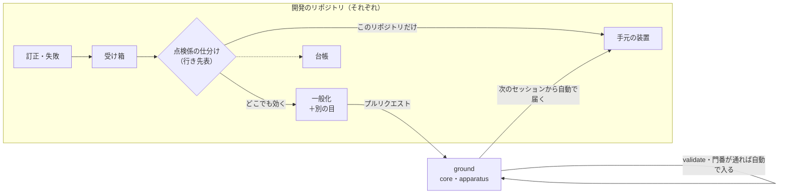

# 装置のコモンズ（Claude Code の装置を一緒に育てる）

> **一言でいうと**：Claude Code で開発しているリポジトリには、AI の動かし方の工夫（CLAUDE.md、スキル、hook、サブエージェント、定期の点検、決定の記録、メモリ）がたまっていきます。そのうち**どのリポジトリでも効くもの**を ground に返し、ground に入ったものは**自動で全部のリポジトリに届く**ようにして、別々の装置を一緒に育てます。

この資料は、Claude Code で開発をしている人と、その装置の世話をしている人に向けたものです。中身の手順は apparatus プラグインの growth-loop スキルにあります。

## 1. 何を解くか

開発のリポジトリの装置は、使うほど賢くなります。訂正されたことを規則にし、何度も起きる失敗を hook で止め、なぜそうしたかを決定の記録に残す。ところが、その工夫はリポジトリの中に閉じていて、ほかのリポジトリでは同じ失敗を一から踏み直します。

逆向きもあります。ground のスキル（人に確認する線引き、資料の書き方など）は、ふだんのチャットでは使われていても、開発のリポジトリの装置には届いていませんでした。似た規則が両側に別々に育ち、少しずつ食い違っていきます。

## 2. 全体の形

流れは2本です。

| 流れ | 何が | どうやって | 人の手番 |
| --- | --- | --- | --- |
| **返す** | どこでも効く規則・作法・hook | リポジトリの点検係（すでにある定期の見回り）が、仕分けのときに「どこでも効く」ものを一般化し、作業を見ていない別のAIに確かめさせてから、ground にプルリクエストを出す | ほぼ無し。ground の門番が人に回すもの（基本ルール、門番そのもの）だけ |
| **取り込む** | ground の core と apparatus | リポジトリの `.claude/settings.json` に ground を宣言しておくと、そのリポジトリで動くセッション（各自の端末・クラウド）に自動で届く | 最初に1回、宣言を入れるだけ |

ground に入った一般則と同じことが手元にもあれば、手元を「上乗せ」（固有の例・数字・道具の名前だけ）に縮めます。これで同じ規則が2か所で別々に育つことがなくなります。

## 3. どこに何を置くか

| もの | 置き場 | 理由 |
| --- | --- | --- |
| どこでも効く作法（確かめ方、組み立て方など） | ground の core | Claude Code に限らず、チャットでも効く |
| 装置そのものの育て方、決定の記録の書き方、hook | ground の apparatus | Claude Code で開発する人だけが使う |
| リポジトリ固有の規則・hook・道具の名前・実測 | そのリポジトリ | 固有の事情は ground に入れない（CLAUDE.md の「入れてはいけないもの」） |
| 何を返した・返さないかの一覧（台帳） | そのリポジトリ | 固有のファイル名が入るため |
| 各自の好み（メモリ） | 各自 | 返さない。ほかの人にも効くと分かったものだけ、一般化して返す |

## 4. 守り

- **事業データを出さない**：返す前に固有名詞・人名・URL・ID・金額を抜く。返す前の別のAIの確認と、ground の自動の点検（validate が電話番号・Notion の URL・メールアドレスらしき文字列を止める）が網になる
- **hook は止められる**：Claude Code にはプラグインの hook を1本だけ外す設定が無いので、apparatus の hook は `.claude/state/hooks-off` に名前を書けば黙る
- **受け箱が無いリポジトリでは何もしない**：apparatus を入れただけでは、ほかのリポジトリにファイルを作らない
- **新しい定期実行を足さない**：点検は各リポジトリにすでにある見回りに相乗りする（making-skills の7）

## 5. いま入っているもの

| プラグイン | スキル・hook | 何をするか |
| --- | --- | --- |
| core | grounding | 言う前に原本を引く。「無い」「直った」「N件」の前に探した範囲を添える |
| core | premise-doubt | 依頼や設計書を、着手前に1回ゼロから疑う |
| core | thesis-first | 材料が多い仕事は、中心の一文を決めてから組み立てる |
| core | step-fidelity | 長い手順書は、手順を写してから入る。飛ばした手順も消さない |
| core | expert-questions | 税理士・役所など外の人への質問は、自分たちの記録を引いてから、即答できる形で聞く |
| apparatus | growth-loop | 学びの行き先表、待合室の決まり、2段の上げ方、常に読む層の上限、点検、ground とのつなぎ方 |
| apparatus | adr-authoring | 決定の記録（ADR）の節の名前、書かないもの、確かめた事実で書く |
| apparatus | hook：capture-feedback | 訂正らしき短い発話を受け箱に1行積む（受け箱があるときだけ） |
| apparatus | hook：wait-loop-guard | 上限の無い待つループ（`until … sleep … done`）を止める |

最初につないだ開発のリポジトリから、一般則だけを書き直して入れたもの。次に返す候補（人に読ませる出力の作法、安全の hook の一般部分、圧縮の前に決めたことを残す仕組み、別の目で見る係など）は、そのリポジトリの台帳にあり、点検係が少しずつ返す。

## 6. 新しいリポジトリをつなぐ

growth-loop スキルの「8. 新しいリポジトリに入れるとき」のとおり。要るのは、`.claude/settings.json` に ground を宣言すること、受け箱と待合室と台帳を空で作ること、CLAUDE.md に1行足すことだけ。
