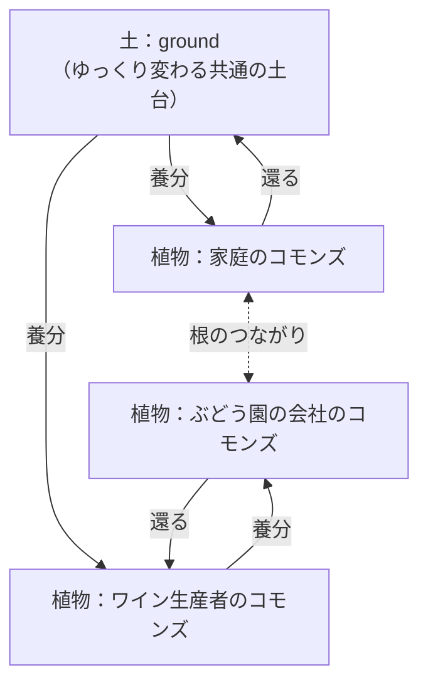
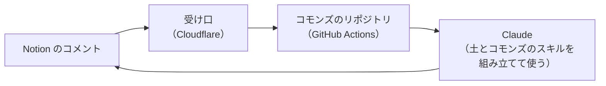

# コモンズのしくみ（はじめての人へ）

> **一言でいうと**：仕事や暮らしのデータは各自の手元に置いたまま、AI（Claude）に渡す**仕事の進め方（スキル）だけ**をみんなで共有し、使うほど全員のAIが賢くなるようにする仕組みです。共通の土台（ground）の上に、家庭・会社・業界のまとまりがそれぞれ「コモンズ」として育ちます。

この資料は、これからコモンズに入る人と、仕組みに興味がある人に向けたものです。AI のチャットや Notion を触ったことがあれば読めるように書いています。

## 1. どんな困りごとを解くか

AI に仕事を頼むと、うまくいく頼み方やコツが少しずつ分かってきます。でもそのコツは、ふつうは一人ひとりのチャットの中に埋もれて終わります。同じ業界の人が同じ失敗を、それぞれ別々にくり返しています。

コモンズでは、そのコツを **スキル**（AI に渡す作業の手順書。「出勤簿から給与の記録を作るときは、まずこれを確かめて…」のようなファイル）にして共有します。誰かが直せば、次の日から全員の AI がその直しを使います。

共有するもの・しないものは、はっきり分けています。

- **共有する**：スキル、基本ルール、データベースの設計図（どんな列を持つ表か）、公開された知識
- **共有しない**：人名・金額・取引先・口座などの事業データ。各自の Notion・会計ソフト・Google Drive に置いたまま

もう一つのねらいは、**AI を契約していない人も自然に使える**ことです。家族や従業員のうち一人が AI を契約していれば、ほかの人は Notion のコメントで AI を呼ぶだけで使えます。人どうしのやり取りの中に、AI がもう一人のメンバーとして入ります。

## 2. 考え方：土と植物

コモンズは、家庭・会社・地域・業界と、何段にも重なっていきます。でも、上の段が下の段を治める「階層」にはしません。上の決まりが現場に合わなくなっても直せなくなり、新しい工夫が上の許可待ちになるからです。

そこで段の違いを、偉さではなく**役割と変わる速さ**の違いとして捉えます。

- **土（土台）**：ゆっくり変わり、変えるときは確かめてから入れる。共通の言葉、守る線引き、何度も使える手順を持つ。何を育てるかは指図しない
- **植物（一つ一つのコモンズ）**：その場の事情に合わせて、速く自由に育つ。同じ土でも畑ごとに違うワインになるように、同じ土台の上でもコモンズごとに違う形に育ってよい

流れは3つです。

1. **養分（土 → 植物）**：土台のスキルは、取り込むと設定しておけば自動で届く。植物はそれを取り込んだうえで、自分に合わせて足してよい
2. **還る（植物 → 土）**：植物が落ち葉や根を土に返して土を肥やすように、コモンズで分かったことは、名前や事情を抜いて土に返す。返すのは義務ではなく、返しておくと次に届く土台が良くなるから返す。採るかどうかは土の段の人が決める
3. **根のつながり（植物 ↔ 植物）**：土を通さず、コモンズどうしが直接分け合ってもよい

植物はいつでも土台の一部を外したり、自分で育て直したりできます。この「離れる自由」があるので、土台は植物を縛りすぎないようになります。

図のとおり、ワイン生産者のコモンズは、家庭と並ぶ植物の一つです。同時に、ぶどう園の会社から見れば土でもあります。どの段も同じ形をしていて、「どの土から養分を取るか」をそれぞれが自分で選びます。

拠り所にしている4つの考え方

| 考え方 | 中身 | ここでの使い方 |
| --- | --- | --- |
| オストロムのコモンズの設計原則 | 長く続く共有資源に共通する条件。問題の大きさごとに、それに合った単位がそれぞれ決める（灌漑なら、畑脇の水路は農家が、幹線の水路は村々の連合が管理し、連合は畑脇の水路に口を出さない）。オストロムはこれを「多中心（ポリセントリック）」と呼んだ | 一つ一つのコモンズが自分のルールを持ち、土台はそれを上書きしない |
| 補完性の原理 | 決めごとはできるだけ近い単位でする。大きな単位は、小さな単位ではできないことだけを引き受ける | 土台が持つのは、守る線引きと共通の言葉と、何度も使える手順だけ |
| オープンソースの上流と下流 | 下流は上流を取り込んで自由に変え、良い変更を上流へ戻す。いつでも枝分かれして離れられる | 養分と還る流れ、離れる自由 |
| 変わる速さの層（ペース・レイヤー） | スチュワート・ブランドの考え方。速く変わる層が新しいことを試し、ゆっくり変わる層が全体を安定させる | 土と植物を、上下でなく速さで分ける |

## 3. いまの形

置き場は、変わる速さで選びます。ゆっくり確かめたい土は **GitHub**（誰が何を変えたかが残り、確かめてから入れられる）、速くみんなで直したい植物は **Notion**（ゲストでもその場で直せる）に置きます。

| コモンズ | 役割 | スキルの置き場 | 取り込む土 |
| --- | --- | --- | --- |
| ground | すべてのコモンズの土台。業種を問わないもの | GitHub [commons-ground/ground](https://github.com/commons-ground/ground)（公開） | Anthropic 公式のスキルなど |
| ワイン生産者 | ワイン生産者に共通のもの（畑・栽培、知識コモンズ） | GitHub [commons-ground/winegrowers](https://github.com/commons-ground/winegrowers)（公開）。何社もで育てるので GitHub | ground |
| 家庭のコモンズ | 家族の暮らしのこと | 自分の Notion のスキル表 | ground |
| ぶどう園の会社のコモンズ | その会社のやり方 | 自分の Notion のスキル表 | ground と winegrowers |
| 一人ひとり | 自分だけのやり方 | 自分の Notion のスキル表、Claude のメモリ | 好きなもの |

ground に入っているもの：基本ルールと資料づくり（core）、調べる・確かめる（research）、組織運営と話し合い（team）、人と労務（labor）、経営（finance）、補助金・助成金（grants）、機械と設備（equipment）。

### 道具ごとに、誰が何を持つか

| 道具 | 全コモンズで1つ | コモンズごと |
| --- | --- | --- |
| GitHub | 団体 `commons-ground` と、土台のリポジトリ | 小さな非公開のリポジトリ1つ（設定と、AI を動かす手順と、鍵だけ） |
| Notion | なし（知識コモンズはワイン生産者のもの） | 自分の場所と、スキル表と、提案と連絡の表。ワークスペースを丸ごと持つ必要はなく、ページ1枚でもよい |
| Anthropic | なし | API キー1つ。費用を払う人がここで決まる |
| 受け口（Cloudflare） | 1つ。どのコモンズの呼び出しかを見分けて振り分ける | なし |

コモンズごとのリポジトリを共有の団体に置かないのは、中に鍵が入るからです。鍵を持つものは、そのコモンズの持ち主のアカウントに置きます。

Notion の境界はワークスペースではなく、**そのコモンズの AI がどのページにつながっているか**です。AI はつながったページの下しか見えないので、同じワークスペースにある別のコモンズのページは読めません。

## 4. 使い方

### 自分の Claude で使う

Claude の「カスタマイズ → プラグイン → 追加 → マーケットプレイスを追加」で `commons-ground/ground` を入れ、使うプラグインを足します。ワイン生産者は `commons-ground/winegrowers` も足します。「自動で同期」をオンにしておけば、土台が直されると自分の Claude にも届きます。くわしくは [はじめかた](getting-started.md)。

### Notion のコメントで AI を呼ぶ

コモンズの AI がいる場所では、Notion のページやコメントで「@コモンズの AI の名前」と書くと、AI が同じスレッドに返事をします。呼んだ人が AI を契約している必要はなく、ゲストでも呼べます。

裏では次のように動いています。

AI は呼ばれるたびに、取り込む土のスキルと、そのコモンズの Notion のスキル表をその場で組み立てて使います。スキル表に行を足せば、次に呼んだときから効きます。

費用の目安は、短い質問で1回 0.05 ドル前後、調べものをする返事で 0.1〜0.2 ドルほどでした（2026年11月の実測）。

## 5. 自分たちに合わせる

軽い順に4段あります。上の段で足りるなら、下の段には降りません。

1. **選ぶ**：使うスキルを選び、要らないものを外す（例：家庭では栽培のスキルを外す）
2. **値を入れる**：スキルが読む設定を書く（例：出勤簿＝自分の会社の「勤怠」の表）
3. **上乗せ**：土台のスキルの後ろに、自分の分を足す。スキル表の行の「上乗せ先」に、足したい土台のスキルの名前を書く（例：労務の出勤簿づくりに「冬は週3日勤務」を足す）
4. **自分のスキル**：土台に無いものを作る（例：家庭の「信頼できる商品選び」）

いちばん大事なのは3の上乗せです。土台のスキルを**コピーして書き換えるのではなく、参照して足す**ので、土台が良くなればその改善が自動で届き、自分が足した分も残ります。コピーすると、その時点で土台の改善が止まります。

ただし、土台の🔒必須ルール（データを外に出さない、など）は、上乗せより優先します。土台は中身にはほとんど口を出さず、ほかの参加者を守る線引きだけを守ります。

## 6. 直し方と育ち方

直したいことは、中身によって行き先が分かれます。

| 直したいこと | どうなるか |
| --- | --- |
| そのコモンズのスキルの中身（何を調べ、どう選ぶか） | AI に頼めば、AI がスキル表を直し、どこを変えたかを返事に書く。Notion のページ履歴から戻せる |
| 仕組みの不具合（エラーになる、読めない、リンクが押せないなど） | AI はスキルに回避策を書かず、「提案と連絡」に宛先「管理者」で書く。すぐに管理者の GitHub に届き、管理者が直す |
| ほかのコモンズにも効きそうな直しやコツ | AI が提案の下書きを書く。人が中身を見て「送る」にすると、土台のリポジトリに届く |

土台（ground・winegrowers）の変更はプルリクエスト（変更の提案）で入れます。自動の点検（形の検証、個人情報らしき文字の検出）が通れば、そのまま入ります。基本ルールと審査のルールを変えるときだけ、人が確かめてから入れます。

## 7. 守ること

- **事業データを土台に入れない**。例やテストにも実データを使わない
- **正本は1か所**。同じスキルを2か所に置かない。移したら、元はすぐスキルとして使われないようにする
- **コピーせずに上乗せ**。公式など、すでに良いスキルがあるものは作り直さず、本家を呼んで足りない分だけ足す
- **スキルに作業のメモを書かない**。スキルには、何をどうするかだけを書く。経緯はプルリクエストや記録に書く

## 8. 新しいコモンズを作るとき

いまは、仕組みの持ち主（管理者）と一緒に作ります。用意するものはこの5つです。

1. Notion：コモンズの場所になるページ1枚と、その下にスキル表と「提案と連絡」の表
2. Notion のインテグレーション（AI がつながる窓口）を作り、上のページにつなぐ
3. GitHub：小さな非公開のリポジトリ（設定ファイル、AI を動かす手順、鍵）
4. Anthropic の API キー（費用を払う人のもの）
5. 受け口に、新しいコモンズの振り分け先を1行足す

AI を動かす部分（runner と受け口）は、今は最初の家庭のコモンズのリポジトリにあります。いくつかのコモンズで動かして形が固まったら、ground の `tools/` に移し、各コモンズは設定ファイルだけを持てばよい形にします。

## 9. まだ決まっていないこと

- 土台の約束を、誰がどう決めるか（参加者全員か、世話役か）。人が増えたときの決め方の方角は [北極星のアイデア](north-star.md) にあります
- 植物が土台を上書きしたとき、土に知らせることを求めるか
- 土が複数あるとき（地域の段ができたときなど）、食い違ったらどちらを優先するか
- 人や会社がコモンズを抜けたとき、その人が書いたスキルを誰のものとして扱うか

## もっと読む

- [はじめかた](getting-started.md)：自分の Claude に入れる手順
- [全体設計](design.md)：最初の2社で始めたときの細かい設計（DB の設計図、改善の回し方、危険度の分け方）
- [北極星のアイデア](north-star.md)：向かう方角と、共有のルールの決め方
- [本家のスキルへの上乗せ](upstream-skills.md)：公式などのスキルをどう取り込んでいるか
