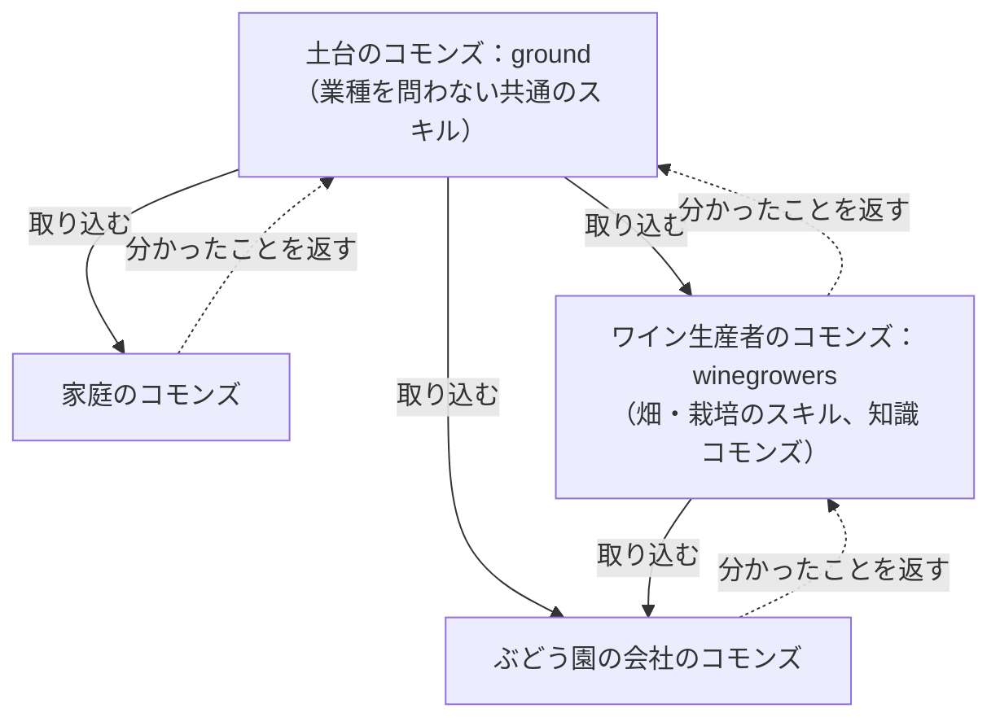
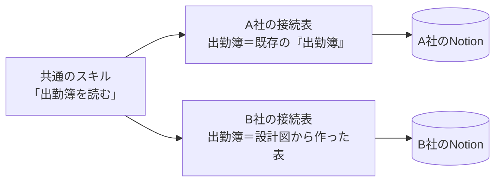
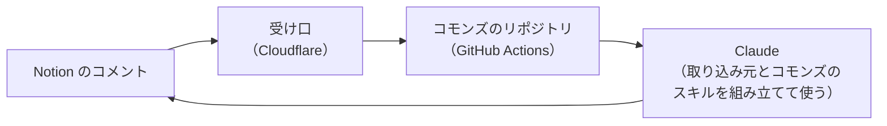

# コモンズのしくみ（はじめての人へ）

> **一言でいうと**：仕事や暮らしのデータは各自の手元に置いたまま、AI（Claude）に渡す**仕事の進め方（スキル）だけ**をみんなで共有し、使うほど全員のAIが賢くなるようにする仕組みです。どのコモンズも使う**土台のコモンズ**（ground）の上で、家庭・会社・業界ごとの**個別のコモンズ**が、それぞれの事情に合わせて育ちます。

この資料は、これからコモンズに入る人と、仕組みに興味がある人に向けたものです。AI のチャットや Notion を触ったことがあれば読めるように書いています。手を動かして始める手順は [はじめかた](getting-started.md) にあります。

## 1. どんな困りごとを解くか

AI に仕事を頼むと、うまくいく頼み方やコツが少しずつ分かってきます。でもそのコツは、ふつうは一人ひとりのチャットの中に埋もれて終わります。同じ業界の人が同じ失敗を、それぞれ別々にくり返しています。

コモンズでは、そのコツを **スキル**（AI に渡す作業の手順書。「出勤簿から給与の記録を作るときは、まずこれを確かめて…」のようなファイル）にして共有します。誰かが直せば、次の日から全員の AI がその直しを使います。

共有するもの・しないものは、はっきり分けています。

- **共有する**：スキル、基本ルール、データベースの設計図（どんな列を持つ表か）、公開された知識
- **共有しない**：人名・金額・取引先・口座などの事業データ。各自の Notion・会計ソフト・Google Drive に置いたまま

もう一つの大きなねらいは、**AI の仕組みを一人ひとりが考えなくてよくなる**ことです。どのスキルを入れ、どの表につなぎ、どんなルールで動かすかという裏側の仕組みを、コモンズで共有して育てます。新しく入った人は、その共同体に合わせて調整された AI を、初日から使えます。

さらに、**AI を契約していない人も自然に使える**ようにしています。家族や従業員のうち一人が AI を契約していれば、ほかの人は Notion のコメントで AI を呼ぶだけで使えます。人どうしのやり取りの中に、AI がもう一人のメンバーとして入ります。

## 2. 全体の形：土台のコモンズと個別のコモンズ

コモンズは、家庭・会社・地域・業界と、何段にも重なっていきます。ただし、上の段が下の段を治める「階層」にはしません。上の決まりが現場に合わなくなっても直せなくなり、新しい工夫が上の許可待ちになるからです。段の違いは偉さではなく、**役割と変わる速さ**の違いです。

- **土台のコモンズ**：どのコモンズも使う共通のスキルと、守る線引き（事業データを外に出さない、など）を持つ。ゆっくり変わり、変えるときは確かめてから入れる。個別のコモンズが何をするかは指図しない
- **個別のコモンズ**：その場の事情に合わせて、速く自由に育つ。土台のスキルを取り込み、自分に合わせて足し、分かったことを土台に返す

スキルの流れは3つです。

1. **取り込む**：土台のスキルは、取り込むと設定しておけば自動で届く
2. **返す**：個別のコモンズで分かったことを、名前や事情を抜いて土台に返す。返すのは義務ではなく、返しておくと次に届く土台が良くなるから返す。採るかどうかは土台の側の人が決める
3. **横で分け合う**：個別のコモンズどうしが、土台を通さずに直接分け合ってもよい

個別のコモンズは、いつでも土台のスキルの一部を外したり、自分で作り直したりできます。この「離れる自由」があるので、土台は個別のコモンズを縛りすぎないようになります。

図のワイン生産者のコモンズは、家庭と並ぶ個別のコモンズの一つです。同時に、ぶどう園の会社から見れば土台でもあります。「土台」は決まった1つの場所ではなく、取り込む元のことです。どのコモンズも同じ形をしていて、どこから取り込むかを自分で選びます。

補足：土と植物のたとえ

この関係は、土と植物にたとえると分かりやすいことがあります。土（土台）はゆっくり変わって植物を支え、何を育てるかは言わない。植物（個別のコモンズ）はその場に合わせて自由に育ち、落ち葉や根を土に返して土を肥やす。同じ土でも畑ごとに違うワインになるように、同じ土台の上でもコモンズごとに違う形に育ってよい。考え方を詰めたときのメモは、Notion の「コモンズの土と植物（考え方のたたき台）」にあります。

拠り所にしている4つの考え方

| 考え方 | 中身 | ここでの使い方 |
| --- | --- | --- |
| オストロムのコモンズの設計原則 | 長く続く共有資源に共通する条件。問題の大きさごとに、それに合った単位がそれぞれ決める（灌漑なら、畑脇の水路は農家が、幹線の水路は村々の連合が管理し、連合は畑脇の水路に口を出さない）。オストロムはこれを「多中心（ポリセントリック）」と呼んだ | 個別のコモンズが自分のルールを持ち、土台はそれを上書きしない |
| 補完性の原理 | 決めごとはできるだけ近い単位でする。大きな単位は、小さな単位ではできないことだけを引き受ける | 土台が持つのは、守る線引きと共通の言葉と、何度も使える手順だけ |
| オープンソースの上流と下流 | 下流は上流を取り込んで自由に変え、良い変更を上流へ戻す。いつでも枝分かれして離れられる | 取り込む・返す流れと、離れる自由 |
| 変わる速さの層（ペース・レイヤー） | スチュワート・ブランドの考え方。速く変わる層が新しいことを試し、ゆっくり変わる層が全体を安定させる | 土台と個別のコモンズを、上下でなく速さで分ける |

## 3. いまの形

置き場は、変わる速さで選びます。ゆっくり確かめたいものは **GitHub**（誰が何を変えたかが残り、確かめてから入れられる）、速くみんなで直したいものは **Notion**（ゲストでもその場で直せる）に置きます。

| コモンズ | 中身 | スキルの置き場 | 取り込む元 |
| --- | --- | --- | --- |
| ground（土台） | 業種を問わないもの | GitHub [commons-ground/ground](https://github.com/commons-ground/ground)（公開） | Anthropic 公式のスキルなど |
| ワイン生産者 | 畑・栽培のスキル、知識コモンズ | GitHub [commons-ground/winegrowers](https://github.com/commons-ground/winegrowers)（公開）。何社もで育てるので GitHub | ground |
| 家庭 | 家族の暮らしのこと | 自分の Notion のスキル表 | ground |
| ぶどう園の会社 | その会社のやり方 | 自分の Notion のスキル表 | ground と winegrowers |
| 一人ひとり | 自分だけのやり方 | 自分の Notion のスキル表、Claude のメモリ | 好きなもの |

ground に入っているプラグイン（スキルをまとめて入れたり外したりする単位）は、[README](../README.md) の一覧にあります。

### 道具ごとに、誰が何を持つか

| 道具 | 全コモンズで1つ | コモンズごと |
| --- | --- | --- |
| GitHub | 団体 `commons-ground` と、土台のリポジトリ | 小さな非公開のリポジトリ1つ（設定と、AI を動かす手順と、鍵だけ） |
| Notion | なし（知識コモンズはワイン生産者のもの） | 自分の場所と、スキル表と、「提案と連絡」の表。ワークスペースを丸ごと持つ必要はなく、ページ1枚でもよい |
| Anthropic | なし | API キー1つ。費用を払う人がここで決まる |
| 受け口（Cloudflare） | 1つ。どのコモンズの呼び出しかを見分けて振り分ける | なし |

コモンズごとのリポジトリを共有の団体に置かないのは、中に鍵が入るからです。鍵を持つものは、そのコモンズの持ち主のアカウントに置きます。

Notion の境界はワークスペースではなく、**そのコモンズの AI がどのページにつながっているか**です。AI はつながったページの下しか見えないので、同じワークスペースにある別のコモンズのページは読めません。

## 4. 同じスキルが、コモンズごとに違う表で動く理由

A社の出勤簿とB社の出勤簿は、名前も場所も違います。それでも同じスキルが両方で動くのは、スキルの中では表を「出勤簿（`attendance`）」のような共通の呼び名（**論理名**）で呼び、各自の **🧭 AI設定ページ**（自分の Notion に置く設定のページ）にある**接続表**が「自分の場合はこの表」と対応づけるからです。スキルは毎回まず設定ページを読みます。

すでに表を持っている人は、作り直さずに対応づけるだけです。接続表に無い表を使うスキルは、勝手に別の表を使わず「この表が未接続です」と止まります。表ごとの設計図は [プラグインとDBの設計図](plugins-and-schemas.md) にあります。

表の列の3種類と、自分用の列をみんなの共通にする流れ

| 種類 | 意味 | 共通のスキルの扱い |
| --- | --- | --- |
| 共通・必須 | 設計図で必ずあるもの | これが無いとスキルは動かない |
| 共通・任意 | 設計図にあるが、入れるかは各自 | あれば使い、無ければ飛ばす |
| 自分用 | 各自が自由に足したもの | 消さない・書き換えない |

自分用の列を足して1か月ほど使い、よく使われていれば「共通・任意にしては」という提案にします。送るのは用途・型・選択肢・件数だけで、値そのものは送りません。任意の列を足しても他の人の表は壊れないので、そのまま取り込めます。任意を必須にする・型を変える・共通から外す変更は、各自の表の作り直しが要るので、使っている全員に知らせてから入れます。

## 5. 使い方

### 自分の Claude で使う

Claude の「カスタマイズ → プラグイン → 追加 → マーケットプレイスを追加」で `commons-ground/ground` を入れ、使うプラグインを足します。ワイン生産者は `commons-ground/winegrowers` も足します。「自動で同期」をオンにしておけば、土台が直されると自分の Claude にも届きます。手順は [はじめかた](getting-started.md)。

Notion AI でも同じスキルを使いたいときは、各自のリポジトリから `tools/notion-skill-sync/` を動かし、自分の Notion のスキル表に写しを入れます。写しは週1回、新しい版に差し替わります。Notion の側では直しません。

### Notion のコメントで AI を呼ぶ

コモンズの AI がいる場所では、Notion のページやコメントで「@コモンズの AI の名前」と書くと、AI が同じスレッドに返事をします。呼んだ人が AI を契約している必要はなく、ゲストでも呼べます。

AI は呼ばれるたびに、取り込み元のスキルと、そのコモンズの Notion のスキル表をその場で組み立てて使います。スキル表に行を足せば、次に呼んだときから効きます。

## 6. 自分たちに合わせる

軽い順に4段あります。上の段で足りるなら、下の段には降りません。

1. **選ぶ**：使うスキルを選び、要らないものを外す（例：家庭では栽培のスキルを外す）
2. **値を入れる**：スキルが読む設定を書く（例：出勤簿＝自分の会社の「勤怠」の表、部門の名前）
3. **上乗せ**：土台のスキルの後ろに、自分の分を足す（例：労務の出勤簿づくりに「冬は週3日勤務」を足す）
4. **自分のスキル**：土台に無いものを作る（例：家庭の「信頼できる商品選び」）

いちばん大事なのは3の上乗せです。土台のスキルを**コピーして書き換えるのではなく、参照して足す**ので、土台が良くなればその改善が自動で届き、自分が足した分も残ります。コピーすると、その時点で土台の改善が止まります。足りないほど違うときは、土台のスキルに「選べる道」を足す提案を出します。

上乗せの置き場は、使う AI によって2つあります。各自の Claude では 🧭 AI設定ページの「自分ルール」の欄、コモンズの AI ではスキル表の行の「上乗せ先」の欄です（どちらかに寄せるかは、9章のまだ決まっていないこと）。

どちらの場合も、土台の🔒必須ルール（データを外に出さない、など）は上乗せより優先します。土台は中身にはほとんど口を出さず、ほかの参加者を守る線引きだけを守ります。

## 7. 直し方と育ち方

### 分かったことの置き場

分かったことは、効く範囲で置き場を分けます。

| 効く範囲 | 例 | 置き場 |
| --- | --- | --- |
| その人だけ | 好み・書き方 | Claude のメモリ |
| そのコモンズだけ | 部門の分け方、家や会社の事情 | 🧭 AI設定ページか、コモンズのスキル表 |
| ほかのコモンズにも | スキルの誤り、足りない手順、効いたコツ | 土台への提案（名前・金額などを抜いて） |

### コモンズの AI に直してほしいとき

| 直したいこと | どうなるか |
| --- | --- |
| そのコモンズのスキルの中身（何を調べ、どう選ぶか） | AI に頼めば、AI がスキル表を直し、どこを変えたかを返事に書く。Notion のページ履歴から戻せる |
| 仕組みの不具合（エラーになる、読めない、リンクが押せないなど） | AI はスキルに回避策を書かず、「提案と連絡」に宛先「管理者」で書く。すぐに管理者の GitHub に届き、管理者が直す |
| ほかのコモンズにも効きそうな直しやコツ | AI が提案の下書きを書く。人が中身を見て「送る」にすると、土台のリポジトリに届く |

### 土台に入れるとき

土台（ground・winegrowers）の変更はプルリクエスト（変更の提案）で入れます。提案は基盤の「提案のしかた（propose-change）」の形で、どの層を変えるか（選べる道を足す／初期設定を変える／必須ルールを変える）と、自分の設定で試した影響を付けます。対立の多くは、初期設定を変えずに選べる道を足すことで、投票せずに片づきます。

自動の点検（形の検証、個人情報らしき文字の検出）が通れば、そのまま入ります。基本ルールと審査のルールを変えるときだけ、人が確かめてから入れます。参加者が増えたときの決め方の方角は [北極星のアイデア](north-star.md) にあります。

## 8. 守ること

- **事業データを土台に入れない**。例やテストにも実データを使わない
- **正本は1か所**。同じスキルを2か所に置かない。移したら、元はすぐスキルとして使われないようにする
- **コピーせずに上乗せ**。公式など、すでに良いスキルがあるものは作り直さず、本家を呼んで足りない分だけ足す（[本家のスキル](upstream-skills.md)）
- **スキルに作業のメモを書かない**。スキルには、何をどうするかだけを書く。経緯はプルリクエストや [旧案と経緯](history.md) に書く

## 9. 新しいコモンズを作るとき

いまは、仕組みの持ち主（管理者）と一緒に作ります。用意するものはこの5つです。

1. Notion：コモンズの場所になるページ1枚と、その下にスキル表と「提案と連絡」の表
2. Notion のインテグレーション（AI がつながる窓口）を作り、上のページにつなぐ
3. GitHub：小さな非公開のリポジトリ（設定ファイル、AI を動かす手順、鍵）
4. Anthropic の API キー（費用を払う人のもの）
5. 受け口に、新しいコモンズの振り分け先を1行足す

AI を動かす部分（runner と受け口）は、今は最初の家庭のコモンズのリポジトリにあります。いくつかのコモンズで動かして形が固まったら、ground の `tools/` に移し、各コモンズは設定ファイルだけを持てばよい形にします。

## 10. 費用の目安（2026年11月）

| 項目 | かかる人 | 目安 |
| --- | --- | --- |
| Claude（自分の Claude で使う人） | 各自 | Pro 月20ドル（年払いなら月17ドル相当）以上 |
| コモンズの AI（Notion のコメントで呼ぶ） | API キーの持ち主 | 使った分だけ。実測で、短い質問は1回0.05ドル前後、調べものをする返事は0.1〜0.2ドル |
| Notion | 各自 | 自分の契約のまま。コモンズのページはゲストでも使える |
| GitHub | なし | 公開リポジトリと、GitHub Actions の無料枠で足りている |
| 受け口・知識コモンズの入口 | なし | Cloudflare Workers の無料枠 |

## 11. まだ決まっていないこと

- 土台の約束を、誰がどう決めるか（参加者全員か、世話役か）
- 個別のコモンズが土台のスキルを上書きしたとき、土台に知らせることを求めるか
- 取り込み元が複数あるとき（地域のコモンズができたときなど）、食い違ったらどちらを優先するか
- 上乗せの置き場を、🧭 AI設定ページとコモンズのスキル表のどちらかに寄せるか
- 人や会社がコモンズを抜けたとき、その人が書いたスキルを誰のものとして扱うか

公式情報で確かめたこと・まだ確かめていないこと

**確かめたこと**
- 非公開の GitHub リポジトリもマーケットプレイスとして追加できる（GitHub をつなぎ、Claude GitHub App にアクセスを与える）
- 自分で追加したマーケットプレイスは「更新を確認」で更新でき、github.com なら「自動で同期」にできる
- プラグインの `userConfig`（入れるときに値を聞く仕組み）はチャットでは使われない。だから各自の設定は Notion の設定ページに置く
- Hook は Cowork と Claude Code で動き、チャットでは動かない
- プラグインの中の `CLAUDE.md` は読み込まれない
- Claude のメモリはアカウントごとで、別のアカウントへ移せない
- カスタムコネクタ（自前の接続口）は Pro・Max でも追加できる
- Notion のコメントで AI を呼ぶ形は、ゲストからでも届く（2026年11月に実測）

**まだ確かめていないこと**
- 作業を始めるときの Hook が、アプリでも基本ルールを読み込むか
- 各自の Notion のスキル表に入れた写しを、Notion AI から使えるか

参照：[Use plugins in Claude](https://support.claude.com/en/articles/13837440-use-plugins-in-claude)・[Create a marketplace](https://code.claude.com/docs/en/plugin-marketplaces)・[Plugin manifest reference](https://code.claude.com/docs/en/plugins/manifest-reference)・[Hooks](https://code.claude.com/docs/en/hooks)・[Agent Skills API（Notion）](https://developers.notion.com/guides/agent-skills/overview)・[Claude pricing](https://claude.com/pricing)・[GitHub pricing](https://github.com/pricing)

## もっと読む

- [はじめかた](getting-started.md)：自分の Claude に入れる手順
- [プラグインとDBの設計図](plugins-and-schemas.md)：プラグインごとの中身と、表の論理名
- [北極星のアイデア](north-star.md)：向かう方角と、共有のルールの決め方
- [本家のスキル](upstream-skills.md)：公式などのスキルをどう取り込んでいるか
- [旧案と経緯](history.md)：検討して変えた案と、移行の記録
- ワイン生産者のコモンズ（畑・栽培、知識コモンズ）は [commons-ground/winegrowers](https://github.com/commons-ground/winegrowers)
