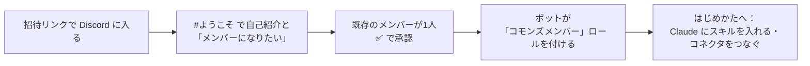

# 見学者とコモンズメンバー（大枠）

コモンズに入るのは軽く、共有財産を使って積み上げるのは「メンバー」になってから。ここではその大枠だけを決める。細かいルールは使いながら足す。

- 状態：大枠（2026-11-26）。まだ厳しく作り込まない
- 関係：[ロードマップ](roadmap.md) の「入口を軽く、書けるのは一段あと」（ground #77）

## 2つの立場

| | 見学者 | コモンズメンバー |
| --- | --- | --- |
| どんな人 | Discord に入ったばかりの人。様子を見に来た人 | コモンズに共感して、共有財産を使い、積み上げる人 |
| Discord | #ようこそ と、読むだけのチャンネル。`/ai` を試せる | すべてのチャンネル。`/ai`・`@コモンズのAI`・`/record` |
| 共有財産を使う | 見るだけ（公開のスキル一覧・知識コモンズの公開ページ） | 自分の Claude にスキルを入れる、コネクタで知識コモンズを読み書きする |
| 積み上げる | しない | #提案 に書く（篩にかかる）、知識を足す、試行の見直しに加わる |

GitHub のスキル置き場は公開なので、見学者でもスキルそのものは読める。メンバーと見学者の違いは「書けるか」「みんなの AI の動きに関われるか」。

## メンバーになる流れ

1. 招待リンクで Discord に入ると、見学者として #ようこそ に着く
2. #ようこそ で、自己紹介と「メンバーになりたい」を書く
3. 既存のメンバーの誰か1人が、その発言に ✅ を付ける（承認は人が明示的にする。AI は承認しない）
4. ボット（コモンズのAI）が「コモンズメンバー」のロールを付け、はじめかたを返す

## 今はまだ決めないこと（あとで足す）

- メンバーになる条件に「コモンズの最低限のルール」への同意を入れるか、その中身
- 承認する人の数（1人で足りるか）、断るときのやり方
- メンバーをやめる・外すときのやり方
- 世話役（GitHub・Discord・Cloudflare の管理）の役割と人数

## 作るもの（決まったら）

| もの | 置き場 |
| --- | --- |
| ロール「コモンズメンバー」と #ようこそ チャンネル | Discord のサーバー設定 |
| ✅ を見てロールを付ける | 中継（`tools/discord-agents`）。いまの常時接続にリアクションの受け取りを足す |
| コネクタはメンバーだけ通す | コネクタの変数 `DISCORD_MEMBER_ROLE` にロールの ID を入れる（対応済み） |
| #提案 はメンバーの発言だけ篩に回す | 中継（篩の入り口） |
| 招待リンクは回数か期限を限る | Discord。切れそうになったら健康診断が知らせる（対応済み） |
