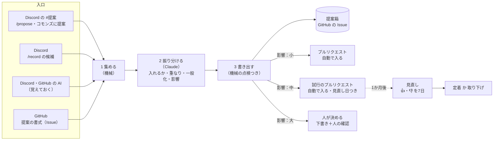

# 篩（ふるい）：提案を、共有の仕組みに入れる前に通す道

> **一言でいうと**：会話・会議・Discord から出てくる提案を、いったん**提案箱**（GitHub の Issue）に集め、AI が **重なりをまとめ、個人や事業の情報を抜き、影響の大きさで3つに振り分けて**から入れます。人が見るのは「影響の大きいもの」と「見直しの時期が来た試行」だけです。動くきっかけは提案が出たときで、定期実行は使いません。

この資料は、コモンズの仕組みを一緒に育てる人に向けた設計書です。Discord と GitHub を使ったことがあれば読めるように書いています。AI が毎回読むルールそのものは、core の [sieve スキル](../plugins/core/skills/sieve/SKILL.md) にあります。この篩自体も試行です（[試行一覧](trials.md)）。

## 1. なぜ篩が要るか

トライアル期間のあいだ、コモンズはアイデアを「まず入れて、おかしければ取り下げる」で育ててきました（core の harvest）。この進め方は速くて良いのですが、入口が増えるにつれて2つの困りごとが出ています。

- **ちょっとした直しまで全部が人の前に並ぶ**。誤字の直しも、新しいスキルも、同じ重さのプルリクエストと知らせになる
- **同じ提案が何本もできる**。Discord の〔提案〕、`/record` の議事録から出た候補、各自の Claude からのプルリクエストが、別々に同じことを言う

もう1つ、会話や会議の中身をそのまま公開のリポジトリに書くと、名前や会社の事情が残ります。共有の仕組みに入るのは「どんな場面で、何が困り、どう直すか」に一般化した文だけにしたい。

篩は、この3つを1か所で引き受けます。

## 2. 全体の流れ

各自の Claude から出すプルリクエスト（propose-change）と、harvest で拾ったものも、同じ sieve スキルのルールで影響を決めてから出します。

## 3. 提案箱：何をどこに置くか

提案箱は、**各コモンズのリポジトリの GitHub の Issue**（ラベル `提案`）です。土台（ground）とワイン生産者（winegrowers）は、それぞれ自分の提案箱を持ちます。土台と個別のコモンズが並ぶ形と同じく、どちらかが相手の箱を治めることはしません。

Issue にしたのは、次の4つがそろうからです。

1. 提案が出たとき・閉じたときに GitHub Actions を起こせる（イベントで動く）
2. プルリクエストと `Closes #12` でつながり、入れたら自動で閉じる
3. 閉じる理由（完了・見送り・重複）が残るので、取り下げた理由を次に読める
4. 鍵も費用も増えない

Notion の「提案と連絡」の表も候補でしたが、Notion は変更をきっかけに Actions を起こす仕組みを持っていないため、定期的に見に行く形になります。

Issue の本文は「一般化した中身」と「篩の記録」に分けます。

| 篩の記録の項目 | 中身 |
| --- | --- |
| 出どころ | /propose・発言の提案・/record・覚えておく・GitHub・harvest。名前だけ |
| 元の発言 | Discord のリンク。中身は写さない |
| 行き先 | このリポジトリ／ground／各自の設定／知識 |
| どの層 | 選べる道を足す／初期設定を変える／必須ルールを変える（propose-change の2） |
| 影響 | 小／中／大と、理由を1行 |
| 関わるもの | スキル名やファイル |
| 同じ声 | まとめた提案の数とリンク |
| 試行・見直し日・結果 | プルリクエスト、1か月後の日付、定着か取り下げとその理由 |

元の発言は Discord に残り、提案箱には一般化した文しか入りません。Discord はコモンズの参加者しか読めないので、リンクを書いても中身は外に出ません。

## 4. 段階ごとに何をするか

| 段階 | すること | 誰が |
| --- | --- | --- |
| 集める | `#提案` の発言と、ほかのチャンネルの〔提案〕〔覚えておく〕で、まだ 🧺 の付いていない発言と、提案箱の新しい Issue を集める | 機械（`collect.py`） |
| 入れるかを決める | 好みやその会社だけの事情・知識・人の作業は、提案箱に入れずに置き場を返す | Claude |
| 重なりをまとめる | 開いている提案・閉じた提案・試行一覧・スキルと見比べる。同じなら「同じ声」に足す | Claude |
| 一般化する | 名前（出どころを除く）・会社・金額・場所・各自の URL を抜き、場面と困りごとに書きかえる | Claude、そのあと機械の点検 |
| 振り分ける | 影響を小・中・大に分ける（次の5章） | Claude |
| 入れる | 直したファイルをプルリクエストにする。元の発言に返事をして 🧺 を付ける | 機械（`apply.py`） |
| 見直す | 見直し日を過ぎた試行について Discord で 👍・👎 を7日聞き、定着か取り下げを決める | Claude と機械 |

AI が書いた文を AI が自分で点検するだけでは、個人の情報の抜けが残ることが分かっています（[CLIOPATRA](https://arxiv.org/abs/2603.09781) は、AI に要約させてから AI に点検させる仕組みでも、病名などが漏れうることを示しました）。そこで篩は、Claude の判断のあとに機械の点検（電話番号・メールアドレス・各自の Notion や Drive の URL・金額らしき文字）を置き、引っかかったものは公開せずに Discord の元の発言に ⏸️ を付けて止めます。

## 5. 影響の大きさで振り分ける

「振り分けが弱い」への答えがここです。今の自動マージの決まり（基本ルールと審査ルールだけ人が確かめる）は変えず、**人に見せるかどうか**を影響で分けます。

| 影響 | 例 | どう入るか | 人に見えるもの |
| --- | --- | --- | --- |
| 小 | 誤字、リンク、出典、言い回し、説明の追加、今の動きを変えない選べる道、AI が覚えることに1行 | 自動で入る。何件かまとめて1本にしてよい | 元の発言への「入れました」の返事だけ |
| 中 | 初期設定を変える、新しいスキル・道具、DB の設計図、書き込みや送信が増える | 試行として自動で入る。1か月後に見直し | `#スキルの相談` に1行。見直しのときに 👍・👎 |
| 大 | 基本ルール・審査ルール、お金・鍵・外部の契約、戻せない操作、意見が割れているもの | 下書き＋ラベル「人の確認」、または Issue で止める | 論点の地図（選択肢と、それぞれで誰が楽になり誰が困るか）と AI のおすすめ |

迷ったら大きい方にします。反対のコメントや 👎 が付いた提案は、小や中でも大にします。

## 6. 起こし方：イベントで動く

| きっかけ | 何が起きるか |
| --- | --- |
| Discord で `/propose`、または「コモンズに提案」 | 提案を `#提案` に載せる仕事（discord-propose）の後ろで、篩が動く |
| Discord で `/ai` の返事が終わる | 同じ流れの後ろで篩が動く。返事に〔覚えておく〕があれば拾う |
| `/record` の議事録ができる | 同じ流れの後ろで篩が動き、出た〔提案〕を拾う |
| GitHub で提案の書式から Issue を出す | Issue が開いたときに篩が動く |

どのきっかけでも、篩はまず Discord と提案箱を見回して「まだ通していないもの」を全部集めます。`#提案` に人が直接書いた発言は、Discord が知らせてくれないので（常に動いているボットが要る）、次に篩が起きたときにここで拾われます。どれか1つのきっかけを取りこぼしても、次に篩が起きたときに拾われます。集めるものが無ければ Claude は動かず、費用はかかりません。見直しも、篩が起きたついでに行います。

篩は同時に1つしか動かないようにしています（重なりの判断がぶつからないように）。

## 7. 先例から借りたもの

| 先例 | 中身 | 篩での使い方 |
| --- | --- | --- |
| Wikipedia の [BOLD, revert, discuss](https://en.wikipedia.org/wiki/Wikipedia:BOLD,_revert,_discuss_cycle) | まず大胆に直し、戻されたら話し合う | 小・中はまず入れ、見直しで戻す |
| Apache の [lazy consensus](https://community.apache.org/committers/lazyConsensus.html) | 決まった期間に反対が無ければ賛成とみなす | 見直しで7日 👎 が無ければ続ける |
| Rust の [RFC の最終コメント期間](https://rust-lang.github.io/rfcs/introduction.html) | 決める前に10日の最後の期間を置き、結論は「入れる・閉じる・保留」の3つ | 見直しの期間と、定着・取り下げ・延長の3つの結論 |
| Kubernetes の [OWNERS](https://kubernetes.dev/docs/guide/owners) | ディレクトリごとに確認する人を決め、ラベルがそろうと自動でマージ | ファイルの場所で「人の確認」を決める（提案中。10章） |
| [vTaiwan](https://participedia.net/method/7387) と Pol.is | 提案・意見・振り返り・法制化の4段。意見を集めて、まとまりをまたぐ合意を探す | 大の提案で、選択肢ごとに誰が困るかを並べる論点の地図 |
| Anthropic の [Clio](https://www.anthropic.com/research/clio) | 会話から個人の情報を抜いた要点を取り出し、似たものをまとめ、少なすぎるまとまりは出さない | 一般化と重なりのまとめ。ただし AI だけの点検に頼らない（4章） |
| [Habermas Machine](https://knightcolumbia.org/content/can-ai-mediation-improve-democratic-deliberation)（Science 2024） | AI が全員の意見から共通の文を作り、人の仲介役より支持された | 将来、大の提案で AI が案文を作るときの手本 |

まだ借りていないもの

- **二次投票**：今は 👍・👎 の数だけを見る。参加者が増え、強く困る少数の声が埋もれるようになったら考える
- **Pol.is のまとまり分け**：今の参加者の数では、まとまりが小さすぎて意味が出ない
- **影響を各自の設定で試す**（北極星の②）：提案が月に数件を超えたら、中の提案から始める

## 8. 人が見るのはここだけ

1. **影響が大の提案**：Issue のラベル `ふるい:人の判断` と、ラベル「人の確認」の付いたプルリクエスト
2. **見直し**：`#スキルの相談` の「見直し：〇〇」に 👍 か 👎 を付ける（付けなくてもよい。何も無ければ延長）
3. **⏸️ の付いた発言**：公開の前の点検で止めたもの。世話役の Claude に言い方を直してもらう
4. **自分の提案への返事**：違うと思ったら、その返事にそう書けば、次に篩が起きたときに直す

## 9. 試行一覧との関係

篩から入った試行は、**提案箱の Issue が正本**です。ラベル `ふるい:試行中` で絞れば、そのコモンズの試行の一覧になります。[試行一覧](trials.md) は、篩より前に入れた試行と、篩そのものの試行を載せる場所として残し、篩から入る試行は書き足しません（同じことを2か所に書かないため）。

## 10. まだ無いもの・確かめていないこと

- **土台に返す提案の運び方**：GitHub Actions の鍵は、そのリポジトリの中しか書けません。winegrowers の篩は、土台に返す提案に `行き先:ground` を付けて Issue にするところまでで、ground に運ぶのは、ground に書き込める参加者の Claude（harvest）です。篩用の GitHub App を作れば自動で運べます
- **篩のプルリクエストでの validate**：篩は GitHub Actions の鍵（GITHUB_TOKEN）でプルリクエストを作ります。GitHub の決まりで、この鍵で作ったプルリクエストではほかのワークフローがそのまま動かず、承認が要る状態になります（[GitHub の説明](https://docs.github.com/en/actions/how-tos/write-workflows/choose-when-workflows-run/trigger-a-workflow)）。篩は validate を名指しで起こしますが、そのためには validate に手動で起こす入口が要ります（「人の確認」の付いた別のプルリクエストで提案中）。篩用の GitHub App があれば、この問題は無くなります
- **ファイルの場所で人の確認を決める**：基本ルール・審査ルールのファイルに触るプルリクエストに、自動でラベル「人の確認」を付ける。今は作った本人が付けているので、付け忘れや、提案に紛れた指示で付かないことがありうる（「人の確認」の付いた別のプルリクエストで提案中）
- **`#提案` に直接書いた発言が、すぐには拾われない**：次にだれかが `/propose`・`/ai`・`/record` を使うか、Issue が開くまで待つ。待ちが長すぎるなら、1日1回だけ篩を起こす定期実行を足すか、常に動くボット（Discord の発言を受け取れる）を置く
- **最初の実行で確かめること**：ボットが Discord の発言に 🧺 を付けられるか（リアクションの権限）、提案箱のラベルが自動で作られるか
