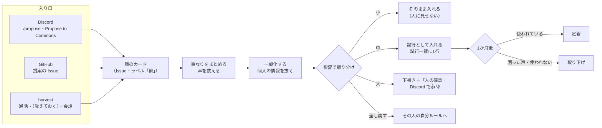

# 篩（ふるい）：提案を、共有物に入れる前にこす仕組み

> **一言でいうと**：Discord・通話・各自の Claude・GitHub から出てきた提案は、そのまま共有のスキルにせず、AI の篩の係が「重なりをまとめる → 個人の情報を抜いて一般化する → 影響の大きさで振り分ける」を通してから入れる。小さな直しは人に見せずに入れ、人が見るのは影響の大きいものだけにする。

この資料は、コモンズの仕組みを一緒に育てる人に向けたものです。手順の正本は core の [sieve スキル](../plugins/core/skills/sieve/SKILL.md)、動かし方は [tools/sieve](../tools/sieve/README.md) にあります。いまは**試行**です（[試行一覧](trials.md)）。

## 1. なぜ篩が要るか

コモンズは、会話や話し合いから仕組みを育てます。入り口はもう5つあります（Discord の〔提案〕、通話の議事録から出る〔提案〕、AI の返事の〔覚えておく〕、各自の Claude からのプルリクエスト、harvest）。

入り口が増えると、2つ困ることが起きます。

- **同じ提案や、ちょっとした直しまで、全部が人の目に上がってくる。** 人の確認は有限で、全部に目を通すと大事なものが埋もれる
- **会話の中身がそのまま共有物に入りそうになる。** 会話には、その会社だけの事情や事業データが混ざっている

篩は、この2つを AI の手番で片づけるための層です。

## 2. 全体の流れ

各自の Claude の propose-change から出るプルリクエストは、カードを通さずに直接入ってかまいません（本文に「どの層」が書いてあり、それで同じ振り分けに当たる）。

## 3. 篩のカード（提案の置き場）

提案1件を、そのコモンズのリポジトリの **GitHub Issue** 1つで持ちます。ラベル「篩」が付いた Issue が篩のカードです。

Issue にした理由は4つです。

- 作る・コメントするだけで GitHub Actions が起きる。定期的に見に行かなくてよい
- 👍／👎のリアクションが、そのまま賛否の印になる
- プルリクエストと相互にリンクでき、取り下げた理由も消えずに残る
- 新しいサービスや契約が要らない

ただし Issue は公開です。だから**元の発言はカードに写さず**、篩の係が一般化した文だけを書きます。元の発言は、参加者だけが見る Discord に残ります。

カードの項目とラベル

| 項目 | 中身 |
| --- | --- |
| タイトル | 〔スキル名〕何をどう変えるか（1行） |
| 本文 | propose-change の4の形（どの層・どんな場面・何が困るか・どう変えるか・困るかもしれない人・戻し方・出どころ） |
| 声 | 同じことを言った人の名前と入り口を1行ずつ。人数が「声の数」 |
| つながり | プルリクエスト、試行一覧の行、まとめたカード |

| ラベル | 意味 |
| --- | --- |
| `篩` | 篩のカードである |
| `影響:小`／`影響:中`／`影響:大` | 振り分けの段 |
| `篩:試行中`・`篩:保留` | 状態。定着・取り下げは、カードを閉じた理由で表す |
| `行き先:<リポジトリ>` | 書き込めない別のリポジトリが行き先のとき。人の Claude が harvest で運ぶ |

## 4. 段階と、それぞれ誰がやるか

| 段階 | AI（篩の係）がすること | 人がすること |
| --- | --- | --- |
| 集める | 入り口からカードを作る | 〔提案〕を出すだけ |
| 重なりをまとめる | 開いた・閉じたカードを探し、同じなら声を足す。取り下げたものと同じなら、その理由が今も当てはまるかを見る | なし |
| 一般化する | 事業データ・ほかの人の名前・会社の事情を抜き、提案の形に書き直す。一般化できないものは差し戻す | なし |
| 振り分ける | 影響を小・中・大に分ける（基準は sieve スキルの4） | なし |
| 入れる | 小と中はプルリクエストにして自動マージに任せる。大は下書き＋「人の確認」 | 大だけ見る |
| 定着か取り下げ | 「取り下げ」のコメントや👎で、取り下げのプルリクエストを出す。見直しの日を過ぎた試行を見る | 違うと思ったら「取り下げ」と書く |

影響の基準は、短く言うと次のとおりです。

- **小**：誤字・出典・言い換え・既定を変えない「選べる道」・〔覚えておく〕。誰の動きも変わらない
- **中**：新しいスキル、初期設定の変更、書き込みや送信が増えるもの。使う人の動きが変わるが、戻せる
- **大**：基本ルール、審査ルール、🔒必須ルール、DB の必須の列、お金・鍵・契約。全員の動きが変わるか、戻しにくい

## 5. 人が見るのはここだけ

1. **Discord の提案のチャンネルに出る1行**：中と大のときだけ出る。小は出ない
2. **ラベル「人の確認」が付いた下書きのプルリクエスト**：大だけ。作った本人が確かめて入れる
3. **大のカードの論点の地図**：反対の声が2つ以上ついたとき、AI が論点を短い文に並べる。それぞれに👍／👎を付け、立場をまたいで👍の多い文を手がかりに、人が決める

これ以外は見なくても回ります。違うと思ったものには、いつでもカードかプルリクエストに「取り下げ」と書けば戻ります。

## 6. 試行一覧との関係

[試行一覧](trials.md) は、人が1枚で今の試行を見渡すための表としてそのまま残します。篩の係は、中を入れたときに1行足し、定着・取り下げのときに状態を書き換えます。カードは1件ごとの経緯（声・まとめた提案・取り下げの理由）を持ち、試行一覧の行からカードにリンクします。小は試行一覧に載せません（ここが「ちょっとした修正まで全部上がってくる」の直し）。

## 7. 起こし方

篩の係は、出来事が起きたときだけ動きます（Discord の `/propose`、Issue を作る、カードにコメントする）。定期実行は使いません。見直しの日が過ぎた試行は、篩の係が動くたびについでに1件見ます。提案が来ない間は見直しも止まりますが、そのあいだは困る人もいません。

拠り所にした先例

| 先例 | 中身 | ここでの使い方 |
| --- | --- | --- |
| Rust の RFC | 言語の意味を変える大きな変更だけが RFC（提案書）を通り、バグの直しや文書は普通のプルリクエストで入る。RFC は担当チームが賛成の印を付けたあと、10日の最終コメント期間（FCP）を置き、反対（concern）が出ればそれが解消されるまで止まる。結論は採用・却下・延期の3つ | 影響の大きさで通り道を分ける。大だけに人の確認を置き、反対が出たら止まる |
| Wikipedia の「大胆に直す → 戻す → 話し合う」（BRD） | まず直してよい。改善でなく、その場で手直しもできないときだけ戻し、戻されたら話し合う | 試行のあいだは入れるのも戻すのも気軽にする |
| Wikipedia の方針の変え方 | 方針は、大事なものほど先に意見を集めてから変える。過去の合意を覆す大きな変更は、知らせて数日の異議の期間を置く | 基本ルール・審査ルールだけは下書きと「人の確認」を通す |
| Pol.is と vTaiwan | 参加者が短い意見に賛成・反対・保留を付け、似た考えのまとまりに分けたうえで、まとまりをまたいで支持される意見を探す。vTaiwan は、オンラインの Pol.is のあと、割れた論点を対面で話し合う | 大のカードで反対が出たら、論点を短い文に並べて👍／👎を付けてもらう |
| LLM による重複の検出（Cupid） | ChatGPT に重複かどうかを判定させるのではなく、要点の言葉を抜き出させ、従来の検索と組み合わせて重複の候補を探す。従来の最良の方法より、上位10件に正解が入る率が5〜8%上がった | 篩の係は、まず言葉を変えて既存のカードを検索し、候補を読んで同じかを決める |

出典：[Rust RFC Book](https://rust-lang.github.io/rfcs/introduction.html)・[Rust lang チームの FCP の決め方](https://lang-team.rust-lang.org/fcp-decisions.html)・[Wikipedia:BOLD, revert, discuss cycle](https://en.wikipedia.org/wiki/Wikipedia:BOLD,_revert,_discuss_cycle)・[Wikipedia:Changing policies and guidelines](https://en.wikipedia.org/wiki/Wikipedia:Changing_policies_and_guidelines)・[Computational Democracy Project の事例](https://compdemocracy.org/case-studies)・[Bridging Voting and Deliberation with Algorithms（vTaiwan の現場から, arXiv 2502.05017）](https://arxiv.org/abs/2502.05017)・[Cupid（arXiv 2308.10022）](https://arxiv.org/abs/2308.10022)

## 8. まだ決まっていないこと

- 篩の振り分けの基準（sieve スキルの4）を、審査ルールとして「人の確認」を通す扱いにするか
- 別のリポジトリ（コモンズ → ground）へ篩の係が直接書き込むための鍵を用意するか。いまは `行き先:ground` のラベルを付けて、人の Claude が運ぶ
- 見直しを、篩が動くついでだけにするか、月に1回の定期実行も足すか
- 通話の〔提案〕と〔覚えておく〕を、harvest を待たずに自動で篩に渡すか
