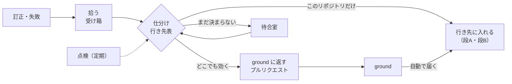

# 装置の育て方

要点は3つ。

1. **学びは種類で行き先が決まる。** 行き先を決めるのに人に聞かない
2. **直す段に持ち主と「1回の終わり」を置く。** 拾う・測るだけでは育たない。止まるのはいつも「直す」段
3. **どのリポジトリでも効くものは、コモンズ（ground）に返す。** ground の更新は自動で取り込む。返して取り込むことで、別々のリポジトリの装置が一緒に育つ

## 1. 装置の置き場

| 置き場 | 何を置くか | いつ読まれるか |
| --- | --- | --- |
| `CLAUDE.md` | 全員が毎回守る規則だけ（1規則1行） | 毎回、全文 |
| `.claude/rules/*.md`（`paths:` つき） | 特定のファイルにだけ効く書き方 | そのファイルを開いたとき |
| スキル（`.claude/skills/`、プラグイン） | 手順・判断の基準 | 呼ばれたとき |
| 作法の文書 | スキルをまたぐ作法（確かめ方、組み立て方など） | 参照されたとき |
| サブエージェント（`.claude/agents/`） | 別の目で見る係、読むだけの係 | 呼ばれたとき |
| hook（`settings.json`、プラグインの `hooks/`） | 文で書いても再発が止まらない、破ると実害が大きいもの | 毎回、自動 |
| 決定の記録（ADR） | なぜその規則・hook があるか | hook の `REF:` から |
| 根拠の文書（rationale） | 実測・経緯・逐語 | 規則の `REF:` から |
| 定期タスク | 点検係などの手順 | 決まった時に |
| メモリ（各自の端末・アカウント） | その人の好み、その端末の事情 | 毎回（各自だけ） |
| 待合室（`learnings.md`） | 行き先がまだ決まらない学び | 書く前に、自分の領域の語で検索して当たった行だけ |

各自の端末だけの置き場（`CLAUDE.local.md`、`settings.local.json`、`~/.claude/`）は、クラウドやほかの人の環境では1つも効かない。恒久の規則はそこに置かない。

## 2. 学びの行き先表

訂正や実際の失敗から学んだことは、次の表で行き先が決まる。

| 学びの種類 | 行き先 | 段 |
| --- | --- | --- |
| 特定の領域のコードの書き方 | `.claude/rules/*.md` | A |
| 特定のスキルの手順・判断基準 | そのスキル | A |
| スキルをまたぐ作法 | 作法の文書 | A |
| サブエージェントの振る舞い | `.claude/agents/*.md` | A |
| その人の好み・その端末の事情 | メモリ | A |
| 毎回全員が守る1行 | `CLAUDE.md` | B |
| 止まる条件・自分で進める線 | 自律の線を決めた文書 | B |
| 破ると実害が大きく、文で書いても再発が止まらない | hook ＋ 決定の記録 ＋ 試験 | B |
| 権限・settings | `settings.json` | B |
| 要件・画面・データの形・税などの決定 | そのリポジトリの決定の置き場 | 人 |
| **どのリポジトリ・どの事業でも効く**（上のどれかで、固有の語を抜いても意味が通る） | **ground に返す**（7） | 返す |
| まだ行き先が決まらない | 待合室 | — |

「どこでも効くか」の見分け方：**そのリポジトリの固有名詞・道具・業務を抜いて書き直しても、規則として意味が通るか。** 通るなら返す。通らないなら、そのリポジトリに置く。半分だけ通るなら、一般則を返し、固有の例や数字は手元に「上乗せ」として残す。

## 3. 待合室（learnings）の決まり

待合室は**行き先が決まるまでの置き場**で、正本ではない。

1. ここに書いても挙動は変わらない。変わるのは行き先に入れたときだけ
2. 書くのは本物のフィードバックだけ：人の訂正、実際に起きた失敗。AI自身の推測や自己生成の所見は書かない（自分の誤りを自分で育てないため）
3. 1件ごとに、日付・出どころ・行き先（決まらなければ「→ 未定」）を付ける。出どころ不明は採らない
4. 同じ趣旨が2回出た（⟳2）か、人が明示したら、行き先へ上げる
5. 上げたら消す（原文は git の履歴に残る）。「昇格済」と書いて残さない
6. 固有名詞・番号のピンを書かない

## 4. 上げ方は2段。1件ずつのチャット承認はしない

- **段A（AIが入れる）**：出どころが人の訂正か実際の失敗で、既存の決定と食い違わないもの。行き先に1〜3行で入れ、プルリクエストにする。人はマージで見る
- **段B（人の確認点にする）**：`CLAUDE.md` の規則行、hook の止め方、自律の線、settings、既存の決定と食い違うもの、税・お金・法令に触れるもの。プルリクエストの「人の確認点」に、はい／いいえで答えられる形で出す
- **返す**：ground へのプルリクエスト。ground の自動の点検（validate と門番）が通れば自動で入る。ground で人の確認が要るもの（基本ルール・門番）は ground の決まりで人に回る

迷ったら段Bに倒す。

## 5. 常に読む層には上限を持つ

| ファイル | 上限の目安 |
| --- | --- |
| `CLAUDE.md` | 200行。規則だけ。経緯・実測は根拠の文書へ、特定ファイル向けは rules へ |
| メモリの索引 | 40行かつ25KB |
| 待合室の全体 | 60KB |
| 待合室の1節 | 12KB |
| 待合室の1件 | 2KB |

上限を超えたら広げない。上げて消すか、節を分ける。点検で上限超えを数えるときは、**超えていて前回より縮んでいない**ときだけ失敗にする（縮んでいる間は注意）。超えたまま毎回失敗を並べると、本当に止まった回と区別できなくなる。

## 6. ループごとに「1回の終わり」を決める

| ループ | 回す人 | 1回の終わり |
| --- | --- | --- |
| 訂正 | 訂正を受けたセッション | 行き先に入れたか、待合室に行き先つきで1行書いた |
| 拾う | hook（`capture-feedback`） | 受け箱に1行積んだ（誤検知込み） |
| 仕分け | 点検係 | 受け箱の未判定が0行 |
| 上げる・返す | 点検係・装置の窓口 | ⟳2以上の未処理が0、または1回の上限（10件）を処理した |
| 点検 | 点検係（定期） | 直せるものを直してから判定し、残った人の手番を確認点に出した |

終わりの条件を満たさずに終えた回は「途中」と記録し、何が残ったかを書く。点検係は、提案を書くだけで終えない。直せるもの（判定済みの行を消す、上げた行を消す、上限10件まで上げる）を直してから判定する。

新しい定期実行は足さない。点検は、そのリポジトリにすでにある定期の見回りに相乗りする（core の making-skills の7）。

## 7. ground とつなぐ

### 取り込む（自動）

リポジトリの `.claude/settings.json` に ground を宣言しておけば、そのリポジトリで動くすべてのセッション（各自の端末・クラウド）に、ground のプラグインが届く。書き方は [references/connect.md](references/connect.md)。

ground のスキルとリポジトリのスキルが同じことを言っていたら、**リポジトリ側を「上乗せ」に縮める**：一般則は ground に任せ、手元には固有の例・数字・道具の名前だけを残し、「一般則は ground の〇〇」と1行書く。食い違ったら、リポジトリ側の目的を優先して進め、ground に「見直し」を返す（making-skills の3「本家とぶつかったとき」と同じ）。

### 返す（点検係・装置の窓口が行う）

行き先表で「どこでも効く」に当たったものを、次の順で返す。

1. **一般化する**：固有名詞・道具の名前・人名・URL・ID・金額・業務の事情を抜く。実害の例は「ある開発の場で、〜が起きた」の形で、数字は丸めずに残してよい（人や事業が特定できないもの）
2. **ground に同じ役目が無いか探す**：ground の `plugins/*/skills/*/SKILL.md` を名前と説明文で探す。あれば新しく作らず、そのスキルへの追記として出す
3. **別の目で見てもらう**：作業を見ていないサブエージェントに、一般化した文と元の文を渡し、①事業の固有の事情・データが残っていないか ②一般化で意味が落ちていないか ③ground の既存のスキルと食い違わないか を見させる。所見を直してから出す
4. **ground へプルリクエストを出す**：core の propose-change の形で。本文に「どの層」と「元にした学びの出どころ（リポジトリ名は書かず、『ある開発の装置』）」を書く。プラグインの `version` を上げる
5. **台帳に書く**：リポジトリの台帳（[references/ledger-template.md](references/ledger-template.md)）の行を「返した」にし、プルリクエストの番号を書く
6. **入ったら、手元を上乗せに縮める**：ground に入ったのを確かめてから（取り込みで届く）、手元の同じ文を上乗せに縮める。段A

### 台帳

返したもの・返さないもの・まだ判定していないものを、リポジトリごとに1枚の台帳で持つ。台帳はリポジトリの中に置く（固有の名前が入るので ground には置かない）。点検係は、台帳の「未判定」と「次の候補」から、1回に数件ずつ返す。

## 8. 新しいリポジトリに入れるとき

1. [references/connect.md](references/connect.md) のとおり、`.claude/settings.json` に ground を宣言する
2. `.claude/learnings.md`（待合室）と `.claude/learnings-inbox.md`（受け箱）を空で作る。受け箱があると、`capture-feedback` の hook が訂正らしき発話を積み始める（無ければ何もしない）
3. 台帳を雛形から作る
4. `CLAUDE.md` に1行：「学びの行き先は apparatus の growth-loop に従う」
5. すでに定期の見回りがあれば、その手順に「6の点検」と「7の返す」を足す。無ければ、点検は人が「装置を点検して」と頼んだときに回す

## 9. この仕組みが見ないもの

- 段Aの「既存の決定と食い違わない」はAIの読み。見落としはマージの人の目に頼る。迷ったら段B
- 上限は大きさしか見ない。小さくても古い・間違った規則は残る
- 「どこでも効くか」の見分けは解釈。固有の事情が残ったまま返すことがある。返す前の別の目（7の3）と、ground の門番（事業データらしき文字列を止める）が網になる
- メモリ（各自の端末・アカウント）は、その人のセッションでしか読めない。点検係がクラウドで回るときは、メモリを数えも返しもできない
- 自動の取り込みは、セッションを始めたときに届く。ground が直されても、走っているセッションには届かない
