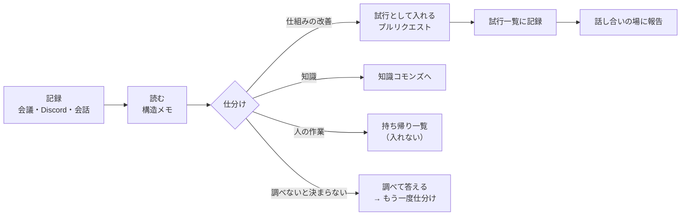

# 改善の収穫

話し合いや日々の使い方の中に出てきたアイデアを拾い、コモンズの仕組み（スキル・ルール・道具・資料）の改善として**実際に入れる**ところまで進める。人がやるのは、記録を渡すことと、出来上がりを見て「違う」と言うことだけ。

## 1. 記録を読む

| 渡されたもの | 読み方 |
| --- | --- |
| Notion のミーティングノート | Notion のコネクタで、要約・決定・アクション・文字起こしを全部読む。要約だけで判断しない（要約は「〜したい」を落としやすい） |
| 文字起こし・メモ・音声 | そのまま読む。音声なら先に文字にする |
| Discord の通話 | 通話の中で `/録音 開始` と打てば、議事録と〔提案〕が自動で Discord に出る（`tools/discord-meeting`）。出た〔提案〕は下の Discord の行で拾う |
| Discord | コモンズのコネクタの `discord_read` で、📌 の付いた発言、「〔提案〕」で始まる発言、コモンズのAIの返事にある「〔覚えておく〕」の行を読む。前回の収穫より後のものだけ |
| GitHub | コモンズのリポジトリの Issue・プルリクエストのコメントで、`claude[bot]` の返事にある「〔覚えておく〕」の行を読む。前回の収穫より後のものだけ |
| 「最近の会話から」 | 過去のチャットを探す道具で、指定の期間（なければ1週間）の会話を見る。同じ直しを何度も頼んでいる所、毎回説明し直している所を探す |

読んだら structure-reading の構造メモを作る。文字起こしは聞き間違いが多い（人名・製品名・専門用語）。意味が通る形に直して読み、自信が無い語はそのまま残して「聞き取り不明」と書く。

## 2. 拾って仕分ける

記録から、「こうしたい」「こうだと便利」「ここが困る」「これは決めた」に当たるものを1件ずつ拾い、次のどれかに分ける。

| 種類 | 例 | 行き先 |
| --- | --- | --- |
| **仕組みの改善** | スキルの手順を足す、新しいスキル、道具の機能、はじめかたの直し、ルールの追加 | 3へ（試行として入れる） |
| **知識** | 栽培・醸造の事実、制度の情報 | knowledge-qa に従って知識コモンズへ（そのコモンズに知識の置き場があるとき） |
| **AIが覚えること** | コモンズのAIの「〔覚えておく〕」の行 | AIの中身の `memory.md` に足す（ground の `tools/ai-member/README.md`）。重なる行は1行にまとめ、スキルにすべき手順はスキルへ |
| **人の作業** | 「〇〇さんが権限を渡す」「招待を送る」 | 持ち帰り一覧に書くだけ。入れない |
| **未決の問い** | 「できるか分からない」「費用はいくら？」 | 調べられるものは今調べて答え、答えが出たら仕組みの改善としてもう一度仕分ける。調べても決まらないものは持ち帰り一覧へ |
| **入れないもの** | 雑談、その会社だけの事情、事業データ | 何もしない |

その会社だけの事情に寄ったアイデアは、propose-change の1に従い、その人の自分ルールやスキルDBに置く案として返す。

## 3. 試行として入れる

**トライアル期間中は、アイデアは聞かずにどんどん入れて、おかしかったら取り下げる。** 入れるか迷ったら入れる。ただし次は止まって人に聞く（when-to-ask）。

- 基本ルール・審査ルールを変える（propose-change の5のとおり、ラベル「人の確認」）
- お金がかかる、外のサービスの契約が要る、鍵・パスワードを扱う
- 戻せない操作（消す、送る、公開の範囲を広げる）

入れるときは：

1. 同じ役目のものが無いかを探し、あれば作らずにそれを直す（making-skills）
2. 1つのアイデアを1つのプルリクエストにする。本文の最初に「**試行**：〇〇の打ち合わせ（日付）から」と書き、propose-change の4の形で、戻し方を必ず書く
3. 人の名前は出どころとして名前だけ書く。会話の中身の引用や事業データは書かない
4. 仕組みが大きくて今日入れきれないものは、最初の一歩（土台・下書き・設計）だけ入れ、残りを試行一覧に書く

## 4. 記録して知らせる

- **試行一覧**：ground の `docs/trials.md` に1行ずつ足す（何を・どこから・いつ見直すか・状態）。見直しの目安は入れてから1か月
- **話し合いの場**：コモンズのコネクタに `discord_post` があれば、`#スキルの相談` に「入れた試行」の短い一覧（プルリクエストのリンク付き）を書く。書く前に、書く内容を利用者に見せる
- **利用者への報告**：入れたもの（リンク付き）、持ち帰り一覧、調べて答えた問い、入れなかったものとその理由

## 5. 見直す

「試行を見直して」と言われたとき、または収穫のついでに、試行一覧で見直しの時期が来たものを見る。

| 様子 | すること |
| --- | --- |
| 使われていて、困った声が無い | 状態を「定着」にする |
| 使われていない、困った声がある | 取り下げのプルリクエストを出し、状態を「取り下げ」にして理由を書く |
| 分からない | もう1か月延ばす。2回延ばしたら取り下げる |

取り下げは失敗ではない。理由を残せば、次に同じアイデアが出たときの材料になる。
