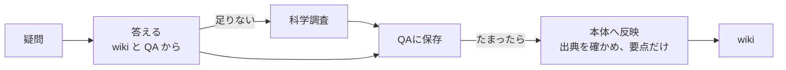

# 知識コモンズのQA

みんなの疑問と、それに答えた調べものを1か所にためて、確かなものだけを本体（`wiki`）に戻す仕組み。

使うDB（場所は🧭 AI設定ページの接続表で引く）：

| 論理名 | 中身 |
|:--|:--|
| `knowledge_qa` | 質問と回答。1行＝1つの疑問 |
| `wiki` | Vikipedia 本体（栽培・醸造などのページ） |
| `references` | 参考文献 |

`knowledge_qa` の列：質問（タイトル）／回答（要点3行まで）／確からしさ（高・中・低）／出典（`references` へのリレーション）／関連ページ（`wiki` へのリレーション）／状態（回答済・反映待ち・反映済・反映しない）／調べた人／日付。回答の全文はページ本文に置く。

## 1. 答える

1. `wiki` と `knowledge_qa` を、問いの言葉と言い換えで検索する。似た質問が `knowledge_qa` にあれば、まずそれを示す
2. 見つかったものだけを根拠に答える。どのページ・どのQAに書いてあるかを必ず添える。書いていないことを補わない
3. 足りないとき：「Vikipediaには○○までしか無い」と言い、科学調査をするか聞く（利用者が「科学調査」と言っていればそのまま始める）

## 2. 保存する

答えたら、聞かずに `knowledge_qa` に1行足す。科学調査を使ったときも同じ。

- 質問：利用者の言葉を、あとで検索しやすい1文に整える
- 回答：結論を3行までにまとめる。全文（科学調査の出力の形そのまま）はページ本文へ
- 出典：`references` に登録済みのものだけリレーションでつなぐ。未登録の出典は本文に書き、状態の横に「未登録 N件」と残す（登録は reference-registration に任せ、勝手に登録しない）
- 状態：wiki の答えだけで足りたら「回答済」。科学調査で新しく分かったことがあれば「反映待ち」
- 事業データ（自分の畑の数字・取引先・金額）は書かない。書くなら「ある生産者の畑では」のようにぼかす

保存したことは答えの最後に1行で伝える（例：「QAに保存しました（反映待ち）」）。

## 3. 本体へ反映する

「QAを本体に反映して」「コモンズの見回り」と言われたとき。あるいは、2で保存したときに「反映待ち」が10件を超えていたら、反映をするか一言聞く（定期実行は作らない）。

対象：状態が「反映待ち」の行。1回で多くても10件。

各行で：

1. **出典を確かめる**：使う出典は、`references` に登録済みで、原文（PDF・本文）が取れたものだけ。未登録なら reference-registration で登録し、原文が取れなければその主張は反映しない。照合は citation-check に任せる
2. **反映する価値を決める**：次のどれかに当たるものだけ反映する。当たらなければ状態を「反映しない」にして理由を1行残す
   - 関連ページに無い事実・数値・条件で、実務の判断が変わる
   - 関連ページの記述が古い・誤っている
   - 同じ疑問が2回以上出ている
3. **書く**：関連ページの該当の節に、要点だけを足す（1件あたり3〜5行まで）。ページが長くなりすぎるなら、節を分けるか詳細を折りたたみに入れる。書き方は core の writing-for-humans、図は diagram に従う。出典は `references` へのリンクで示す
4. **記録する**：QAの状態を「反映済」にし、反映先の節をリンクする

書き込みは page-review と同じく「ページを書き換えるのは1か所から」：反映の案を一覧で見せ、利用者がまとめて承認したら書く。共有の `wiki` を書き換えるので、承認なしに書かない。

## してはいけないこと

- 出典を確かめずに本体へ書く。AI要約（`references` の要約欄も含む）を根拠にする
- QAの答えを、そのまま本体に貼る（要点に絞る）
- 定期実行（ルーチン）を作る。反映のきっかけは利用者の一言か、保存時の件数チェックだけ
