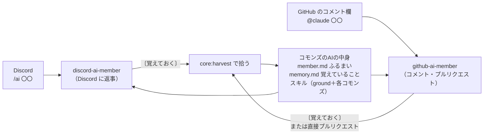

# コモンズの AI（Discord と GitHub に同じ AI を置く）

コモンズの AI は、**入口が2つで、中身は1つ**です。Discord で `/ai` と打っても、GitHub のコメント欄で `@claude` と書いても、同じふるまいと同じ「覚えていること」を読んだ Claude が答えます。やりとりで覚えたことは同じ置き場に戻るので、どちらの入口で育てても、両方の AI が賢くなります。

## 中身の置き場

| もの | 中身 | 場所 |
| --- | --- | --- |
| ふるまい | 性格、答え方、守ること | 各コモンズのリポジトリの `discord/member.md` |
| 覚えていること | やりとりで直されたこと、決まったこと | 同じフォルダの `memory.md` |
| 呼び名・モデル・上限額 | Discord の返事の設定 | 同じフォルダの `config.json` |
| スキル | ground と各コモンズのプラグイン | `plugins/` |
| 入口ごとの決まり | Discord：`discord-ai-member/run.py` の中、GitHub：`github.md` | ここ（ground の `tools/`） |

フォルダ名が `discord/` なのは、Discord の入口を先に作ったためです（中身は両方の入口で共通）。

## 育ち方

1. やりとりの中で、人に直されたことや決まったことが出ると、AI は返事の最後に `〔覚えておく〕（1行）` と書く
2. GitHub で、記憶の置き場のリポジトリで呼ばれたときは、AI がその行を `memory.md` に足すプルリクエストも出す（自動マージで入る）
3. それ以外（Discord、別のリポジトリ）の行は、各自の Claude が core:harvest で拾い、`memory.md` に足すプルリクエストにする
4. 次に呼ばれたとき、どちらの入口の AI も新しい `memory.md` を読んで答える

`memory.md` は長くなりすぎないよう、harvest のときに重なりを1行にまとめ、古くなった行は消す。スキルにすべき手順になったものは、スキルに移して `memory.md` から消す。

## GitHub の入口を足す（各コモンズのリポジトリ）

1. 組織に [Claude の GitHub アプリ](https://github.com/apps/claude) が入っていること（コメントは `claude[bot]` の名前で出る）
2. `ANTHROPIC_API_KEY` を、組織の Actions secret（全リポジトリで使える）か、そのリポジトリの secret に入れる。API の費用はキーの持ち主に請求される
3. `.github/workflows/github-ai.yml` を置く（ground の同名ファイルが見本）。`member_repo` と `member_dir` に、そのコモンズの AI の中身の場所を書く

答えるのは、そのリポジトリに書き込める人が `@claude` と書いたときだけです（公開リポジトリで知らない人に費用を使われないため）。

## まだ無いもの

- Discord の AI が自分で `memory.md` に書き足す道（いまは harvest 経由）
- 知識コモンズ（Notion）を両方の AI から読む道具（入口の MCP サーバーが Discord ログイン専用のため、機械用の鍵が要る）
