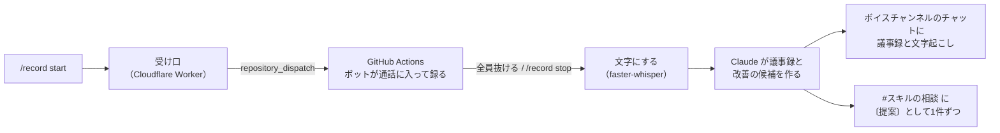

# discord-meeting

コモンズの Discord の通話を録って、文字起こし・議事録・改善の提案まで自動で作る仕組みです。人がやるのは、通話の中で `/record start` と打つことだけです。

## 流れ



- **起こし方はイベントだけ**：定期実行は使わない。コマンドで GitHub Actions の仕事が1つ立ち上がり、録音の間だけ動いて終わる
- **話す人ごとに録る**：Discord は話す人ごとに音が分かれて届くので、誰が話したかを推測しなくてよい
- **止まり方**：人間が全員抜けて1分たつ、`/record stop`、上限（既定180分）のどれか
- **改善の候補は〔提案〕として出すだけ**：仕組みに入れるかどうかは、篩（ふるい）の仕組みが決める
- **残し方**：音声はどこにも残さない。文字起こしと議事録は Discord にだけ置く。公開リポジトリの Actions で動くので、ログにも成果物にも中身を出さない
- **知らせ方**：録り始めたらボイスチャンネルのチャットに「🔴 録音中」と書く。録られたくない人は抜けられる

## 置き場所

| もの | 場所 |
|:--|:--|
| 録る | `record.mjs`（discord.js と @discordjs/voice。Discord の通話の暗号化 DAVE に対応した版） |
| 文字にする | `transcribe.py`（ポッドキャストの文字起こしと同じ faster-whisper の large-v3-turbo） |
| 議事録と提案 | `digest.py`（core:harvest の1と2に従う Claude） |
| 仕事の流れ | `.github/workflows/discord-meeting.yml`（各コモンズから呼び出す） |
| コマンドと受け口 | `tools/discord-ai-member` の `commands.json`・`worker.js` |
| 提案を出すチャンネル・上限額 | 呼び出し側の `discord/config.json` の `proposal_channel`・`meeting_max_budget_usd` |

## 呼び出し側の workflow

```yaml
on:
  repository_dispatch:
    types: [discord-record]
concurrency:
  group: discord-meeting
jobs:
  meeting:
    uses: commons-ground/ground/.github/workflows/discord-meeting.yml@main
    with:
      payload: ${{ toJSON(github.event.client_payload) }}
    secrets:
      ANTHROPIC_API_KEY: ${{ secrets.ANTHROPIC_API_KEY }}
      DISCORD_BOT_TOKEN: ${{ secrets.DISCORD_BOT_TOKEN }}
```

## 前もって要るもの

- ボットに、ボイスチャンネルの「表示」「接続」の権限
- 受け口の Worker を、コマンドを振り分ける版（`tools/discord-ai-member/worker.js`）にしておく
- コマンドの登録（`discord-commands` の workflow を1回動かす）

## 費用

| もの | 費用 |
|:--|:--|
| GitHub Actions | 公開リポジトリなら無料 |
| 文字起こし | Actions の中で動くので無料（1時間の通話で、文字にするのに数十分かかる） |
| 議事録づくり（Claude） | 1回あたり `meeting_max_budget_usd`（既定1ドル）まで。API キーの持ち主に請求される |

## 確かめていないこと（試行）

- Discord は、ボットが音を受け取ることを正式には文書にしていない。@discordjs/voice も「安定は保証しない」としている。最初の通話で、録れるかを確かめる
- GitHub Actions の実行環境から Discord の通話（UDP）につながるかも、最初の通話で確かめる。つながらなければ、録る部分だけを常に動いている小さなサーバーに移す
